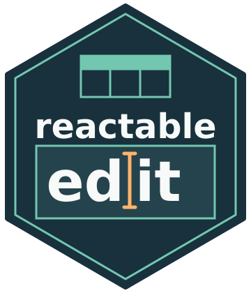

# reactableEdit



**reactableEdit** is an independent fork of [reactable](https://github.com/glin/reactable), originally developed by
Greg Lin. Maintained by Samuel JOBERT, it adds native Shiny cell editing, server validation, configurable input
states, row addition and removal, and rich tooltips. It is not an official release of the original project.

Development and issue reports: <https://github.com/samuel-jobert/reactableEdit>.
This development fork is not currently published on CRAN.

Interactive data tables for R, based on the
[React Table](https://github.com/tanstack/table/tree/v7) library and made with
[reactR](https://github.com/react-R/reactR).

## Features
- Native Shiny cell inputs with explicit server acceptance or rejection
- Configurable editing indicators and disabled inputs by row, column, or cell
- Browser row addition and removal with Shiny callbacks
- Rich tooltips for cells, inputs, and headers
- Sorting, filtering, pagination
- Grouping and aggregation
- Built-in column formatting
- Custom rendering via R or JavaScript — use Shiny HTML tags and HTML widgets in tables
- Expandable rows and nested tables
- Conditional styling
- Virtual scrolling for large tables
- Works seamlessly within R Markdown documents and Shiny apps

## Upstream demos

The following links demonstrate the original package's shared features, not this fork's extensions.
For editing and tooltip examples, see [the local guide](@travail/README.md) and
[the Shiny demo source](design/cell-editing/cell-editing-test.Rmd).
- [Twitter Followers](https://glin.github.io/reactable/articles/twitter-followers/twitter-followers.html)
- [Women's World Cup Predictions](https://glin.github.io/reactable/articles/womens-world-cup/womens-world-cup.html)
- [NBA Box Score](https://glin.github.io/reactable/articles/nba-box-score/nba-box-score.html)
- [CRAN Packages](https://glin.github.io/reactable/articles/cran-packages/cran-packages.html)
- [Spotify Charts](https://glin.github.io/reactable/articles/spotify-charts/spotify-charts.html)
- [Popular Movies](https://glin.github.io/reactable/articles/popular-movies/popular-movies.html)
- [Demo Cookbook](https://glin.github.io/reactable/articles/cookbook/cookbook.html)
- [100k Rows](https://glin.github.io/reactable/articles/100k-rows.html)
- [100k Rows (Virtualized)](https://glin.github.io/reactable/articles/100k-rows-virtual.html)
- [Shiny Demo](https://glin.github.io/reactable/articles/shiny-demo.html)

## Installation
Install from a local checkout (the directory name does not need to match the package name):
```r
# Run from the checkout directory
install.packages(".", repos = NULL, type = "source")
```

Once the fork has been published to GitHub, install it with:
```r
# install.packages("devtools")
devtools::install_github("samuel-jobert/reactableEdit")
```

The package is loaded with `library(reactableEdit)`. Existing function names (`reactable()`, `colDef()`,
`reactableOutput()`, etc.), the `Reactable` JavaScript API, widget classes, and `reactable.*` options are unchanged.
Both R packages can be installed side by side, but avoid loading them together or mixing their widgets in the
same HTML document: they share function names, widget bindings, and JavaScript globals.

## Usage
To create a table, use `reactable()` on a data frame or matrix:
```r
library(reactableEdit)

reactable(iris)
```

<!-- pkgdown:example -->
[](https://glin.github.io/reactable/articles/examples.html)

You can embed tables in **R Markdown** or **Quarto** documents:
````
```{r}
library(reactableEdit)

reactable(iris)
```
````

Or use them in **Shiny** applications:
```r
library(shiny)
library(reactableEdit)

ui <- fluidPage(
  reactableOutput("table")
)

server <- function(input, output) {
  output$table <- renderReactable({
    reactable(iris)
  })
}

shinyApp(ui, server)
```

To learn more about the shared API, check out the upstream examples below.

## Upstream examples
- [Basic Usage](https://glin.github.io/reactable/articles/examples.html#basic-usage)
- [Sorting](https://glin.github.io/reactable/articles/examples.html#sorting)
- [Filtering](https://glin.github.io/reactable/articles/examples.html#filtering)
- [Searching](https://glin.github.io/reactable/articles/examples.html#searching)
- [Pagination](https://glin.github.io/reactable/articles/examples.html#pagination)
- [Virtual Scrolling](https://glin.github.io/reactable/articles/examples.html#virtual-scrolling)
- [Grouping and Aggregation](https://glin.github.io/reactable/articles/examples.html#grouping-and-aggregation)
- [Column Formatting](https://glin.github.io/reactable/articles/examples.html#column-formatting)
- [Custom Rendering](https://glin.github.io/reactable/articles/examples.html#custom-rendering)
- [Embedding HTML Widgets](https://glin.github.io/reactable/articles/examples.html#embedding-html-widgets)
- [Footers and Total Rows](https://glin.github.io/reactable/articles/examples.html#footers)
- [Expandable Rows and Nested Tables](https://glin.github.io/reactable/articles/examples.html#expandable-row-details)
- [Conditional Styling](https://glin.github.io/reactable/articles/examples.html#conditional-styling)
- [Table Styling](https://glin.github.io/reactable/articles/examples.html#table-styling)
- [Theming](https://glin.github.io/reactable/articles/examples.html#theming)
- [Column Groups](https://glin.github.io/reactable/articles/examples.html#column-groups)
- [Column Resizing](https://glin.github.io/reactable/articles/examples.html#column-resizing)
- [Sticky Columns](https://glin.github.io/reactable/articles/examples.html#sticky-columns)
- [Row Names and Row Headers](https://glin.github.io/reactable/articles/examples.html#row-names-and-row-headers)
- [Cell Click Actions](https://glin.github.io/reactable/articles/examples.html#cell-click-actions)
- [Language Options](https://glin.github.io/reactable/articles/examples.html#language-options)
- [Shiny](https://glin.github.io/reactable/articles/examples.html#shiny)
- [Cross-Widget Interactions with Crosstalk](https://glin.github.io/reactable/articles/examples.html#cross-widget-interactions)
- [JavaScript API](https://glin.github.io/reactable/articles/examples.html#javascript-api)

## Browser Support
| [](https://godban.github.io/browsers-support-badges/)<br>Edge | [](https://godban.github.io/browsers-support-badges/)<br>Firefox | [](https://godban.github.io/browsers-support-badges/)<br>Chrome | [](https://godban.github.io/browsers-support-badges/)<br>Safari | [](https://godban.github.io/browsers-support-badges/)<br>Opera |
| --------- | --------- | --------- | --------- | --------- |
| Edge | last 2 versions | last 2 versions | last 2 versions | last 2 versions |

## License

MIT, as in the original project. The original [LICENSE](LICENSE), authors, and bundled library notices are retained.
See [LICENSE.note](LICENSE.note) for the full MIT terms, fork provenance, and copyright for the modifications.
